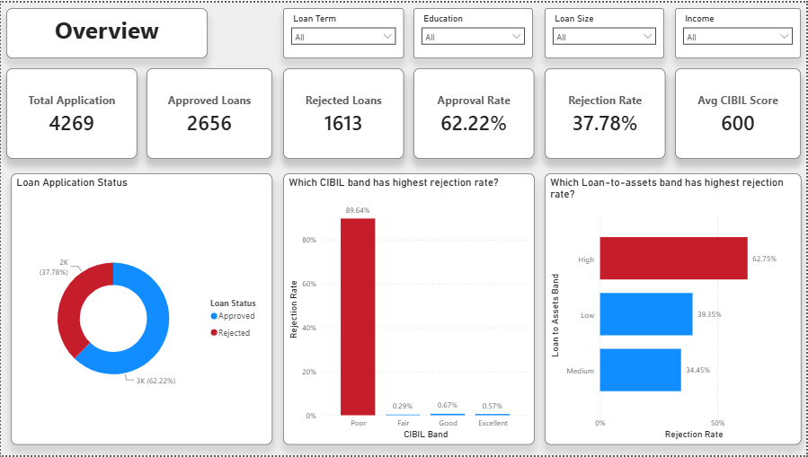
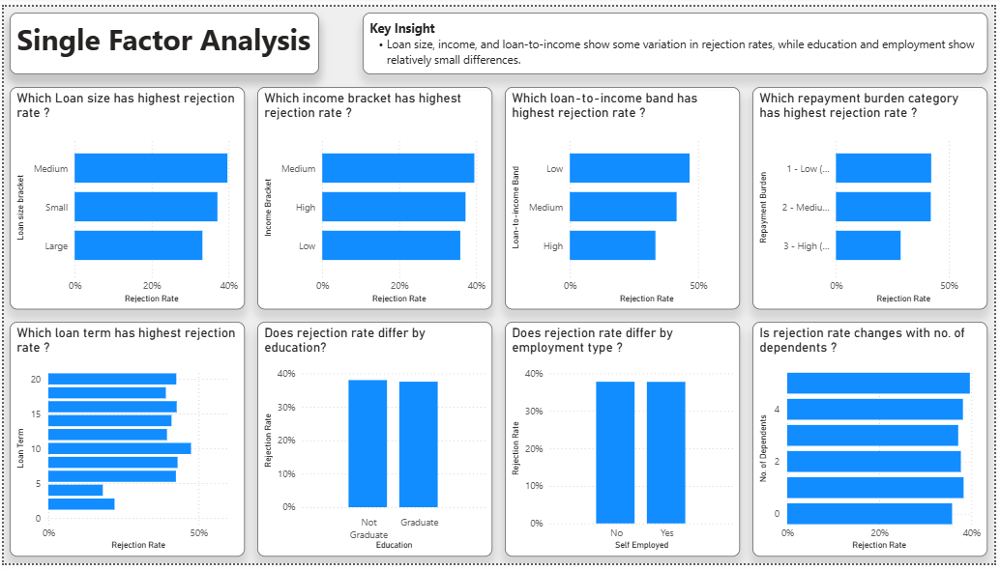
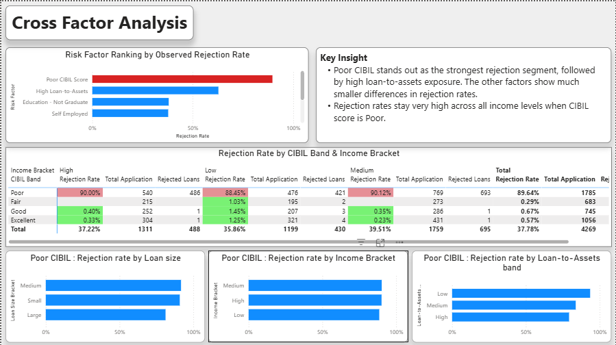
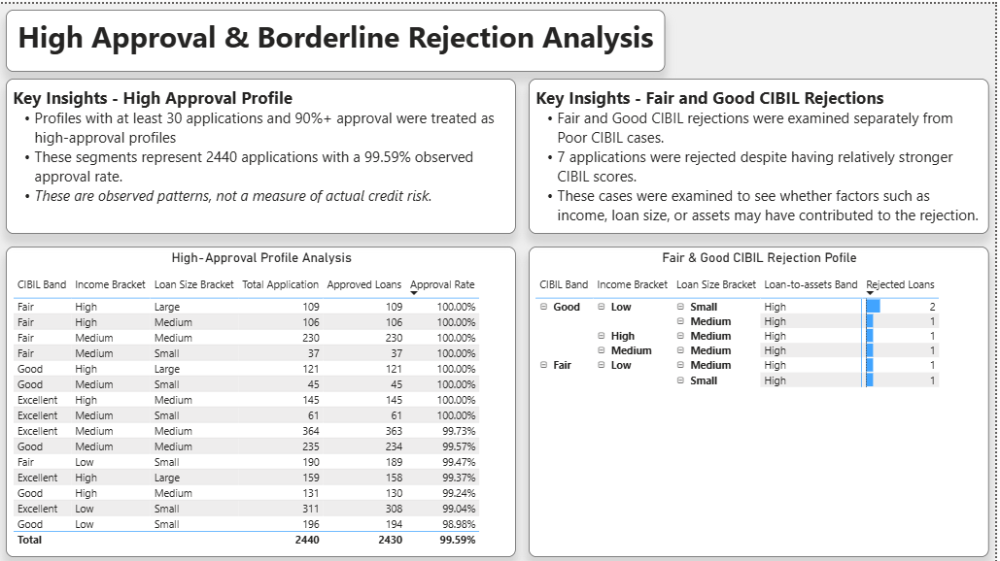

# Loan Approval Risk Analysis
An end-to-end data analysis project using SQL and Microsoft Power BI to investigate loan approval and rejection patterns across applicant and loan characteristics.

The analysis covers 4,269 loan applications and examines creditworthiness, income, loan characteristics, employment, education, financial ratios, and repayment burden to identify which factors are most strongly associated with rejection outcomes.


## Executive Summary
The analysis found that CIBIL score was the strongest observed separator of loan outcomes in the dataset.

Applicants in the Poor CIBIL band had an observed rejection rate of 89.64%, substantially higher than the other CIBIL bands. High loan-to-assets exposure was another notable signal, with an observed rejection rate of 62.75%.

Other characteristics such as education, employment type, and income showed comparatively smaller differences from the overall rejection rate of 37.78%.

These findings represent patterns observed in the available dataset and do not establish that any individual factor causes loan rejection.

## Business Problem
Loan approval decisions involve multiple applicant and loan characteristics. Understanding which characteristics are associated with higher rejection rates can help identify risk segments and support more consistent lending analysis.

This project investigates:
            
- Which applicant and loan characteristics are associated
with higher rejection rates?

- Which factors provide the strongest separation between approved and rejected applications?

- Do combinations of factors reveal higher- or lower-rejection segments?

- Which applicant profiles demonstrate consistently high observed approval rates?

- Which Fair and Good CIBIL applicants were rejected despite having relatively stronger credit profiles?

## Key Business Questions
### 1. What is the overall approval and rejection rate?

Measure the total number and percentage of approved and rejected applications.

### 2. Which individual factors are associated with higher rejection rates?

The analysis compares rejection rates across:

- CIBIL bands
- Loan size
- Loan term
- Income brackets
- Loan-to-income bands
- Loan-to-assets bands
- Repayment burden
- Education
- Employment type
- Number of dependents

### 3. Which combinations of factors show different rejection patterns?

Cross-factor analysis examines combinations such as:

- CIBIL band × income
- CIBIL band × loan size
- CIBIL band × loan-to-assets
- Poor CIBIL × loan size
- Poor CIBIL × income

### 4. Which applicant profiles have high observed approval rates?

The analysis identifies high-approval segments while applying a minimum application-volume threshold to avoid treating very small groups as reliable patterns.

### 5. Which stronger-CIBIL applicants were still rejected?

The analysis investigates rejected applicants in the Fair and Good CIBIL bands to identify borderline profiles that may require further investigation.

## Dataset
- **Source**: [Loan Approval Prediction Dataset — Kaggle](https://www.kaggle.com/datasets/architsharma01/loan-approval-prediction-dataset)
- **Records**: 4,269 loan applications
- **Data preparation**: Cleaned and transformed using Excel before importing into MySQL for analysis.

The project uses a cleaned loan approval dataset containing 4,269 applications and information about applicants, loans, financial ratios, assets, and approval decisions.

### Key Fields 
| Field	| Description |
|--- |---|
| `loan_id`  | Unique application identifier |
| `no_of_dependents` |	Number of dependents |
| `education` |	Graduate or Not Graduate |
| `self_employed` |	Employment status |
| `income_annum` |	Applicant annual income |
| `loan_amount` |	Requested loan amount |
| `loan_term` |	Loan term |
| `cibil_score` |	Applicant CIBIL score |
| `loan_status` |	Approved or Rejected |
| `total_assets` |	Total reported assets |
| `loan_to_income` |	Loan-to-income ratio |
| `cibil_band` |	Poor, Fair, Good, or Excellent |
| `loan_to_assets` |	Loan-to-assets ratio |
| `estimated_monthly_repayment` |Estimated monthly repayment |
| `emi_to_income` |	EMI as a proportion of income |
| `income_bracket` |	Low, Medium, or High |
| `loan_size_bracket` |	Small, Medium, or Large |
| `loan_to_income_band` |	Low, Medium, or High |
| `loan_to_assets_band` |	Low, Medium, or High |

## Data Quality & Cleaning

Before performing the analysis, the dataset was reviewed for invalid, inconsistent, and unexpected values.

### Issue 1 — Negative Residential Asset Value

#### What was found

- 28 rows contained `residential_assets_value = -100000`.
- All 28 occurrences had the same negative value.
- No other asset-value column contained negative values.

#### Why this is a problem

A residential asset value should not logically be negative. Therefore, the value was treated as a data-quality issue.

The dataset does not provide enough information to determine whether `-100000` represents a placeholder, an encoding issue, or another data-entry problem.

#### Cleaning Treatment

The 28 negative values were replaced with `0` in Excel.

This was applied only to the `residential_assets_value` column.

#### Validation

After cleaning:

- Negative residential asset values: **0**
- Records corrected: **28**
- Other asset-value columns: **No negative values identified**

## Analytical Approach
The analysis was performed in several stages:

### 1. Data Preparation
- Reviewed the available loan application data.
- Created analytical bands for continuous variables.
- Categorized applicants based on CIBIL score, income, loan size, and financial ratios.
- Prepared the data for SQL analysis and Power BI reporting.

### 2. Overall Outcome Analysis
Calculated:

- Total applications
- Approved applications
- Rejected applications
- Approval rate
- Rejection rate

### 3. Single-Factor Analysis
Calculated rejection rates across individual applicant and loan characteristics to determine which variables show meaningful differences in outcomes.

### 4. Cross-Factor Analysis
Compared multiple variables together to identify whether combinations reveal patterns that are not visible from single-factor analysis.

### 5. Profile Analysis
Identified:
- High-approval applicant segments
- High-rejection applicant segments
- Borderline rejection profiles among Fair and Good CIBIL applicants

## Dashboard
The Power BI dashboard is divided into four analytical pages.
### 1. Overview
Provides a high-level summary of the portfolio:

- Total applications
- Approved applications
- Rejected applications
- Approval rate
- Rejection rate
- Average CIBIL score
- Approval vs. rejection distribution
- Rejection rate by CIBIL band
- Rejection rate by loan-to-assets band

### Dashboard Preview


### 2. Single-Factor Analysis
Compares observed rejection rates across individual characteristics:

- Loan term
- Loan size
- Repayment burden
- Education
- Income
- Loan-to-income
- Number of dependents
- Employment type

The purpose is to determine which individual variables meaningfully separate rejection outcomes and which show relatively small differences.

### Dashboard Preview


### 3. Cross-Factor Analysis
Examines how multiple characteristics interact.

Key comparisons include:

- CIBIL band vs. income
- CIBIL band vs. loan size
- CIBIL band vs. loan-to-assets
- Poor CIBIL vs. loan size
- Poor CIBIL vs. income

This helps move beyond isolated factor analysis and identify combinations associated with different observed rejection rates.

### Dashboard Preview


### 4. High-Approval & Borderline Rejection Profiles
This page focuses on two types of profiles:

#### High-Approval Profiles

Applicant combinations with:
- At least 30 applications
- At least 90% observed approval rate

The minimum-volume threshold reduces the likelihood of highlighting very small groups with an accidental 100% approval rate.

#### Borderline Rejections

Rejected applicants within Fair and Good CIBIL bands are examined to understand cases where rejection occurred despite relatively stronger credit scores.

### Dashboard Preview


## Key Findings
### Overall Portfolio

| Metric | Result |
|---|---:|
| Total applications | 4,269 |
| Approved applications | 2,656 |
| Rejected applications | 1,613 |
| Approval rate | 62.22% |
| Rejection rate | 37.78% |

### Major Observations

- **Poor CIBIL applicants had an observed rejection rate of 89.64%**, making CIBIL score the strongest observed separator of loan outcomes in this dataset.
- **High Loan-to-Assets applicants had an observed rejection rate of 62.75%**, indicating a notable difference in rejection outcomes for this segment.
- **10-year loan terms had an observed rejection rate of 47.48%**, which was higher than the overall rejection rate.
- **Not Graduate applicants had an observed rejection rate of 38.02%**, which is close to the overall rejection rate of 37.78%.
- **Self-Employed applicants had an observed rejection rate of 37.77%**, almost identical to the overall rejection rate.
- **Low-income applicants had an observed rejection rate of 35.86%**, which was lower than the overall rejection rate.
- **High Loan-to-Income applicants had an observed rejection rate of 33.37%**, showing that a higher value did not correspond to a higher rejection rate in this dataset.
- The analysis shows that **not every applicant characteristic is a meaningful standalone separator of rejection outcomes**.

## Business Insights
The analysis suggests several practical observations from the dataset:

- **CIBIL score should receive greater attention during risk segmentation**, as the Poor CIBIL segment shows a substantially higher observed rejection rate than other CIBIL bands.

- **Loan-to-assets exposure can provide an additional segmentation signal**, particularly when evaluated alongside CIBIL score and other financial characteristics.

- **Education and employment status show limited separation** in this dataset and should not be treated as major standalone rejection indicators.

- **Cross-factor analysis provides more context than single-factor analysis**, particularly when CIBIL is examined together with income, loan size, and asset exposure.

- **High-approval profiles should be treated as observed historical patterns rather than guaranteed low-risk applicants.**

- The analysis can help identify segments that deserve further investigation, but a production lending decision would require additional variables, statistical validation, and predictive modeling.

## Methodology

### CIBIL Bands
CIBIL scores were grouped into four categories:
- Poor
- Fair
- Good
- Excellent

Rejection rates were calculated for each band to compare observed loan outcomes across different levels of creditworthiness.

### Repayment Burden
Repayment burden was derived from the `emi_to_income` ratio.

| EMI-to-Income Ratio | Repayment Burden |
|---|---|
| `< 0.20` | Low |
| `0.20 – 0.40` | Medium |
| `> 0.40` | High 

### Loan-to-Income
The `loan_to_income` ratio was grouped into three analytical bands:

| Range | Band |
|---|---|
| 1.50 – 2.00 | Low |
| 2.01 – 3.00 | Medium |
| 3.01 – 4.00 | High |

These ranges were created for analysis and should not be interpreted as industry-standard lending thresholds.

### Loan-to-Assets
The `loan_to_assets` ratio was grouped into three analytical bands:

| Range | Band |
|---|---|
| 0.18 – 0.50 | Low |
| 0.51 – 0.90 | Medium |
| 0.91 – 1.33 | High |

These ranges were created for this analysis and are not intended to represent formal lending standards.

### High-Approval Profile Definition
A profile was included in the high-approval analysis when:

- Total applications were at least **30**
- Observed approval rate was at least **90%**

The minimum application threshold was used to reduce the influence of very small groups that could produce misleadingly high approval rates.

## Tools & Technologies
- **Microsoft Excel** — initial data cleaning and validation
- **MySQL / SQL** — data exploration, segmentation, and rejection-rate analysis
- **Microsoft Power BI** — interactive dashboard and visualization
- **Power Query** — data transformation
- **DAX** — calculated measures and dashboard logic
- **CSV** — source data format

## Repository Structure
```text
loan-approval-risk-analysis/
│
├── README.md
│
├── Data/
│   └── loan_approval_cleaned.csv
│
├── loan_approval_risk_analysis.sql
│
├── loan_approval_risk_analysis.pbix
│
└── images/
    ├── overview.png
    ├── single-factor.png
    ├── cross-factor.png
    └── high-approval-borderline.png
```

## How to Run
### Power BI Dashboard

1. Install Microsoft Power BI Desktop.
2. Download the final `.pbix` file.
3. Open the file in Power BI Desktop.
4. Navigate through the dashboard pages.
5. Use the available slicers to explore different applicant and loan segments.

### SQL Analysis

1. Open the SQL file.
2. Import or connect to the loan dataset in MySQL.
3. Run the queries to reproduce the analysis.
4. Review the results used for the Power BI dashboard.

The SQL syntax may require minor adjustments depending on the database environment.


## Limitations
- The dataset does not contain an application date, so approval and rejection trends over time cannot be analyzed.

- The analysis is based on observed relationships and does not establish causation.

- The dataset may not represent the behavior of a real-world lending population.

- Some analytical thresholds and bands were manually defined for this project.

- The analysis is descriptive and should not be treated as a production credit-scoring or loan-approval model.

- No statistical significance testing has been performed.

- No predictive machine-learning model has been developed.

- High-approval profiles represent historical patterns in the dataset and should not be interpreted as guaranteed low-risk applicants.

- Data-quality issues identified during validation were corrected before analysis, but the original dataset may contain additional undocumented issues.

## Future Improvements
- Add application dates to enable approval and rejection trend analysis.
- Perform statistical significance testing to determine whether observed differences between groups are statistically meaningful.
- Develop a predictive model to estimate rejection probability for new applications.
- Create a reusable risk-scoring framework instead of relying only on manually defined factor rankings.
- Add confidence intervals for low-volume segments.
- Add drill-through functionality for individual loan applications.
- Implement automated data-quality checks before analysis.
- Compare model predictions with actual approval outcomes using appropriate evaluation metrics.